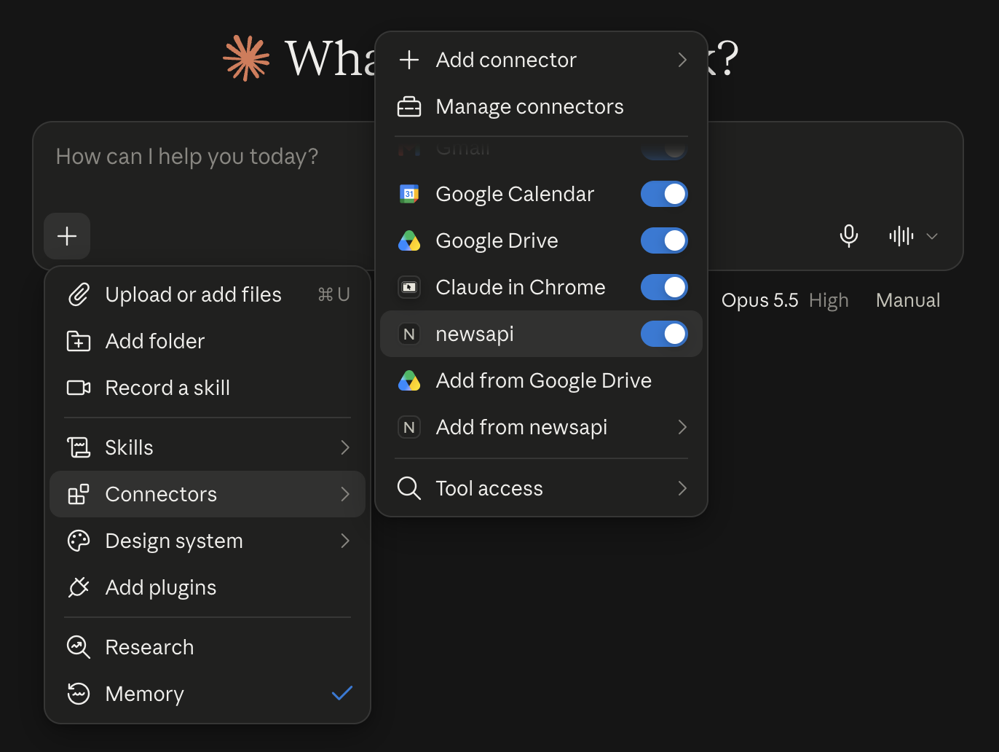

# Running the local server

The npm package `newsapi-mcp` runs the same tools as the hosted server on your own
machine, over stdio. Use it when your MCP client cannot connect to remote servers, when
you want to authenticate with an API key, or when you develop the server.

Most users do not need it: the hosted server at `https://mcp.newsapi.ai/mcp` needs no
install (see the [README](../README.md)).

## Requirements

- Node.js 20 or newer ([nodejs.org](https://nodejs.org/)). Check with `node --version`.
- An MCP client that runs local servers: Claude Desktop, Claude Code, VS Code, Cursor,
  Windsurf, Gemini CLI and others.

## Authentication

The server authenticates in one of two ways.

**Event Registry login** (default). The first request opens your browser to log in at
Event Registry; tokens are kept in your OS credential store (Keychain, Credential
Manager, Secret Service) and refreshed automatically.

```bash
npx newsapi-mcp login    # log in up front
npx newsapi-mcp logout   # forget the stored login
```

The login listens on `http://127.0.0.1:51337/callback` (51338 and 51339 as fallbacks).
If no Event Registry account is linked to your login yet, sign in once at
[eventregistry.org/login](https://eventregistry.org/login) and retry.

**API key.** Set `NEWSAPI_KEY` and no login happens. Get a key at
[newsapi.ai/register](https://newsapi.ai/register) (free tier: a one-time 2,000 tokens).

## Standard configuration

This JSON works in most clients. Drop the `env` block to use the login instead of a key.

```json
{
  "mcpServers": {
    "newsapi": {
      "command": "npx",
      "args": ["-y", "newsapi-mcp"],
      "env": {
        "NEWSAPI_KEY": "your_api_key_here"
      }
    }
  }
}
```

## Client setup

<details>
<summary><strong>Claude Desktop</strong></summary>

Open **Settings → Developer → Edit Config**, which opens `claude_desktop_config.json`.
Paste the standard configuration, save and restart Claude Desktop. The MCP
[guide](https://modelcontextprotocol.io/docs/develop/connect-local-servers) has
screenshots.

The first news question opens your browser at Event Registry to log in (unless the
configuration sets `NEWSAPI_KEY`); Claude Desktop shows nothing meanwhile, so watch for
the browser window. On macOS the first run may also ask whether `newsapi` may use the
Keychain: allow it, or the login is not remembered.

If Claude answers from web search instead, check that the server is switched on for the
chat: in the chat box open **+ → Connectors** and make sure `newsapi` is on (connectors
are usually on by default):



</details>

<details>
<summary><strong>Claude Code</strong></summary>

```bash
claude mcp add --scope user newsapi -- npx -y newsapi-mcp                              # login
claude mcp add --scope user newsapi -e NEWSAPI_KEY=your_api_key_here -- npx -y newsapi-mcp   # API key
```

`--scope user` makes the server available in every project; drop it for the current
project only. Approve the first tool call with "always allow" so later calls run without
a prompt. The [research skills](skills.md) work with this server as it is named here
(`newsapi`); install the plugin for the skills and disable its bundled hosted server
under `/mcp` if you prefer the local one.

</details>

<details>
<summary><strong>VS Code</strong></summary>

```bash
code --add-mcp '{"name":"newsapi","command":"npx","args":["-y","newsapi-mcp"],"env":{"NEWSAPI_KEY":"your_api_key_here"}}'
```

Or follow the VS Code MCP [guide](https://code.visualstudio.com/docs/copilot/customization/mcp-servers#_add-an-mcp-server)
with the standard configuration. The server is then available to the GitHub Copilot agent.

</details>

<details>
<summary><strong>Cursor</strong></summary>

Paste the standard configuration into `~/.cursor/mcp.json` (or `.cursor/mcp.json` in a
project).

</details>

<details>
<summary><strong>Windsurf</strong></summary>

Follow the Windsurf MCP [documentation](https://docs.windsurf.com/windsurf/cascade/mcp)
with the standard configuration.

</details>

<details>
<summary><strong>Gemini CLI</strong></summary>

Follow the Gemini CLI MCP [guide](https://github.com/google-gemini/gemini-cli/blob/main/docs/tools/mcp-server.md#configure-the-mcp-server-in-settingsjson)
with the standard configuration.

</details>

<details>
<summary><strong>Antigravity</strong></summary>

Add the standard configuration through the Antigravity settings or its configuration
file.

</details>

<details>
<summary><strong>Qodo Gen</strong></summary>

Open the [Qodo Gen](https://docs.qodo.ai/qodo-documentation/qodo-gen) chat panel in
VS Code or IntelliJ → Connect more tools → + Add new MCP → paste the standard
configuration.

</details>

## Troubleshooting

| What you see                                                               | What to do                                                                                                             |
| -------------------------------------------------------------------------- | ---------------------------------------------------------------------------------------------------------------------- |
| `npx: command not found`                                                   | Node.js is not installed or not on the PATH. Install it from [nodejs.org](https://nodejs.org/) and restart the client. |
| The client reports the server failed to start                              | Run `npx -y newsapi-mcp --help` in a terminal; the error it prints names the cause.                                    |
| The browser never opens                                                    | Run `npx newsapi-mcp login` in a terminal and open the URL it prints. Ports 51337 to 51339 must be free.               |
| "No Event Registry account is linked to this login"                        | Sign in once at [eventregistry.org/login](https://eventregistry.org/login) with the same account, then retry.          |
| "Your NewsAPI.ai login has expired"                                        | Run `npx newsapi-mcp login` again.                                                                                     |
| Claude answers from web search and never calls the server (Claude Desktop) | The connector is off for that chat. Open **+ → Connectors** and switch on `newsapi` (screenshot above).                |
| An old version keeps running after a release                               | `npx` caches the package. Use `newsapi-mcp@latest` in the configuration, or run `npx -y newsapi-mcp@latest` once.      |
| "Authentication failed. Check NEWSAPI_KEY is valid."                       | The key is wrong or was revoked. Check it at [newsapi.ai](https://newsapi.ai/).                                        |

## Development

```bash
npm install
npm run dev            # tsx hot reload, reads .env
npm test               # vitest
npm run build:bundle   # single-file dist/index.js, what npm publishes
```

`CLAUDE.md` describes the architecture; `CONTEXT.md` the vocabulary.
