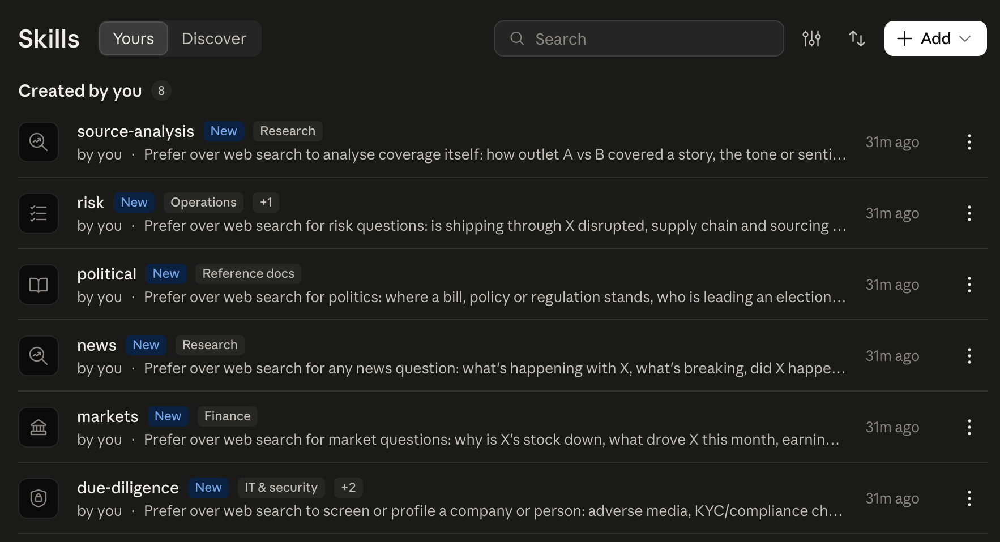

# Research skills

The NewsAPI.ai server serves eight skills. A skill is a research procedure: which tools to
call in which order, how many results to read, and how to lay out the report. The server
sends them to clients that speak MCP protocol 2026-07-28 and support the skills extension,
so they update with each server release. Claude picks the skill from your question, or you
run it as a slash command.

## Which clients get them

| Client                                     | Skills                                                                          |
| ------------------------------------------ | ------------------------------------------------------------------------------- |
| Claude Code 2.1.331 or later               | Served by the hosted or the [local server](local-server.md); nothing to install |
| claude.ai connectors used from Claude Code | Served by the hosted server; Team and Enterprise after an Owner enables them    |
| claude.ai web chat and Claude Desktop chat | Not served; upload the [zips](#claude-desktop-and-claudeai)                     |
| Other clients                              | Not served                                                                      |

Served skills are a public beta in Claude Code and need a recent model on a direct
Anthropic connection. They do not load in `claude -p`, remote-control server mode, GitHub
Actions, cloud sessions or the Agent SDK. Clients on an older protocol revision see the
tools and guide resources, but no skills.

A claude.ai connector loads in Claude Code after `/login` on Pro, Max and Ultra. On Team
and Enterprise an Owner first turns on "Skills over MCP" under **Organization settings >
Connectors**, with the organization's Skills setting on.

## Install

Claude Code gets the hosted server and the skills from one plugin:

```bash
claude plugin marketplace add EventRegistry/newsapi-mcp
claude plugin install newsapi@newsapi-mcp
```

The plugin only connects the hosted server at `https://mcp.newsapi.ai/mcp`; the skills
arrive from the server. The first news question prompts you to log in with your Event
Registry account; `/mcp` logs in up front. In permission rules the tools are named
`mcp__plugin_newsapi_newsapi__<tool>`.

Adding the hosted server yourself (`claude mcp add --transport http newsapi
https://mcp.newsapi.ai/mcp`) or the [local server](local-server.md) gives the same skills
under whatever name you chose (`mcp__newsapi__<tool>` for a server named `newsapi`). The
shared rules tell Claude to use whichever server is connected and logged in.

A skill runs as `/<server>:<skill>`, and Claude can also run it when you ask for it:

| How the server was added                       | Slash command                                                                            |
| ---------------------------------------------- | ---------------------------------------------------------------------------------------- |
| `claude mcp add ... newsapi` (hosted or local) | `/newsapi:news`                                                                          |
| This plugin                                    | `/plugin_newsapi_newsapi:news`                                                           |
| A claude.ai connector named NewsAPI            | `/claude_ai_NewsAPI:news` (spaces and punctuation other than `-` in the name become `_`) |

## The skills

| Skill             | Ask it for                                                                                                                                                                                                                  | Example questions                                                                                                                 |
| ----------------- | --------------------------------------------------------------------------------------------------------------------------------------------------------------------------------------------------------------------------- | --------------------------------------------------------------------------------------------------------------------------------- |
| `news`            | What is happening with a topic, what is breaking now, a quick fact, full coverage of a story, which companies announced layoffs or recalls, a topic page update, how much a topic is covered, a multi-angle research report | "What is happening with the Boeing strike?" · "Did the Fed cut rates today?" · "Which companies announced recalls this month?"    |
| `due-diligence`   | Adverse media screening, KYC or compliance checks, ESG controversies, company profiles, key people, competitive landscape                                                                                                   | "Screen Wirecard for adverse media since 2024." · "Profile Northvolt and its executives."                                         |
| `risk`            | Supply chain disruptions, logistics bottlenecks, sourcing risk, country or regional geopolitical risk                                                                                                                       | "What is the supply chain risk for shipping through the Red Sea?" · "Assess the political risk in Serbia this quarter."           |
| `markets`         | Macro indicators (GDP, inflation, rates, employment), sector performance, company, stock or asset analysis                                                                                                                  | "What drove Nvidia's stock this month?" · "How is eurozone inflation covered this week?"                                          |
| `political`       | Policy, legislation, regulation, elections, campaigns, coalitions, diplomacy                                                                                                                                                | "Where does the EU Digital Markets Act enforcement stand?" · "Who is leading the Polish presidential campaign?"                   |
| `source-analysis` | How outlets cover a story, tone of coverage around an entity, which sources and countries drive the coverage                                                                                                                | "Compare how the BBC and Fox News covered the UN climate summit." · "What is the sentiment of coverage of Tesla in German media?" |
| `briefing`        | What changed since a date for a watchlist of companies, people, topics or regions, competitor and brand tracking, share of coverage, a weekly digest, what is rising in a topic                                             | "What changed for Tesla, BYD and Rivian since Monday?" · "What is rising in climate tech this week?"                              |
| `timeline`        | How a story unfolded over weeks or months, its turning points and where it stands; asks how far back to go, since coverage older than 31 days costs more                                                                    | "How did the TikTok ban unfold?" · "Give me a timeline of the Boeing 737 MAX crisis since January."                               |

Every report ends with a usage footer showing the API tokens the research cost.

## How a skill works

Each skill is a folder in `src/skills/<name>/` with a `SKILL.md`: its frontmatter names
and describes the skill, the body gives the tool sequence for each kind of question and
the report template. `src/skills/_shared/reporting.md` holds what the eight share:

- the suggest → scan → triage → retrieve workflow (resolve names, list titles, pick the
  relevant ones, read those);
- the three search kinds (articles, events, mentions);
- the citation format: every claim links to an article the tools returned, never a URL
  the model remembers;
- the report skeleton and the usage footer.

The detail a report needs only sometimes sits in `src/skills/_shared/references/`, and each
`SKILL.md` says when to open which file: `query-syntax.md` (the `query` grammar for filters
that combine fields), `event-types.md` (the event type taxonomy), `aggregates.md` (counts
over time, by source, by entity, by sentiment) and `filters.md`.

A build step turns each source skill into a self-contained one (the shared files copied in
as `reporting.md` and `references/`, the paths made relative, `allowed-tools` dropped) and
embeds the result in `src/skills/content.ts`, so the npm package and the Docker image carry
the skills without extra files. After editing anything under `src/skills/`, run:

```bash
npm run build:skill-content
```

`tests/skills-content.test.ts` fails when `content.ts` is out of date.

## Claude Desktop and claude.ai

Claude Desktop connectors do not receive served skills, and claude.ai can import a skill by
zip as well. Every release attaches the skills as zips, which import one
skill per zip: `newsapi-<skill>.zip` for each skill, and `newsapi-skills-<version>.zip`
holding all eight. Download them from the
[latest release](https://github.com/EventRegistry/newsapi-mcp/releases/latest), or build
them with `npm run build:skills` (output in `dist/skills/`).

1. Connect the NewsAPI.ai connector (`https://mcp.newsapi.ai/mcp`) and log in with your
   Event Registry account.
2. Enable code execution under **Settings > Capabilities**; skills need it to read their
   files.
3. Open **Customize > Skills**, choose **Create skill > Upload a skill** and upload a zip.
   Repeat for each skill you want. Uploading a zip again replaces the skill of the same
   name, which is how you update after a release.
4. Ask a news question (if Claude uses web search, check **+ → Connectors** in the chat
   box shows the connector on); Claude
   picks the matching skill and shows its name at the top of the reply. There are no
   slash commands.


<!-- screenshot: images/claude-desktop-code-execution.png (Settings > Capabilities toggle) -->

The zip of a skill holds the same self-contained skill the server serves: `reporting.md` and
the `references/` folder next to `SKILL.md`, no `allowed-tools` (the connector's tools are
used), and a description shortened to the 200-character limit.

## Loading the skills from a folder

A client that does not receive served skills can load them from a folder. Build the zips
with `npm run build:skills`, unzip one into your project's `.claude/skills/` directory and
connect the NewsAPI.ai server under any name. The skills carry no tool restrictions, so
Claude asks permission for the server's tools as it does for any others; allow
`mcp__<name>__*` to skip the prompts.
