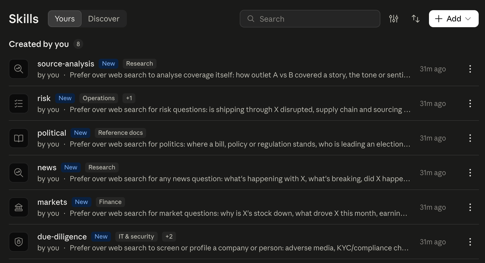

# Research skills

The Claude Code plugin ships six skills. A skill is a research procedure: which tools to
call in which order, how many results to read, and how to lay out the report. Claude
Code picks the skill from your question, or you name it with its slash command.

## Install

```bash
claude plugin marketplace add EventRegistry/newsapi-mcp
claude plugin install newsapi@newsapi-mcp
```

The plugin connects the hosted server at `https://mcp.newsapi.ai/mcp`. The first news
question prompts you to log in with your Event Registry account; `/mcp` logs in up
front. In permission rules the tools are named `mcp__plugin_newsapi_newsapi__<tool>`.

The skills also work with the [local server](local-server.md) added as `newsapi`
(`mcp__newsapi__<tool>`): each skill pre-approves both servers, and the shared rules tell
Claude to use whichever one is connected and logged in.

## The skills

| Skill                      | Ask it for                                                                                                                                                                                                                  | Example questions                                                                                                                 |
| -------------------------- | --------------------------------------------------------------------------------------------------------------------------------------------------------------------------------------------------------------------------- | --------------------------------------------------------------------------------------------------------------------------------- |
| `/newsapi:news`            | What is happening with a topic, what is breaking now, a quick fact, full coverage of a story, which companies announced layoffs or recalls, a topic page update, how much a topic is covered, a multi-angle research report | "What is happening with the Boeing strike?" · "Did the Fed cut rates today?" · "Which companies announced recalls this month?"    |
| `/newsapi:due-diligence`   | Adverse media screening, KYC or compliance checks, ESG controversies, company profiles, key people, competitive landscape                                                                                                   | "Screen Wirecard for adverse media since 2024." · "Profile Northvolt and its executives."                                         |
| `/newsapi:risk`            | Supply chain disruptions, logistics bottlenecks, sourcing risk, country or regional geopolitical risk                                                                                                                       | "What is the supply chain risk for shipping through the Red Sea?" · "Assess the political risk in Serbia this quarter."           |
| `/newsapi:markets`         | Macro indicators (GDP, inflation, rates, employment), sector performance, company, stock or asset analysis                                                                                                                  | "What drove Nvidia's stock this month?" · "How is eurozone inflation covered this week?"                                          |
| `/newsapi:political`       | Policy, legislation, regulation, elections, campaigns, coalitions, diplomacy                                                                                                                                                | "Where does the EU Digital Markets Act enforcement stand?" · "Who is leading the Polish presidential campaign?"                   |
| `/newsapi:source-analysis` | How outlets cover a story, tone of coverage around an entity, which sources and countries drive the coverage                                                                                                                | "Compare how the BBC and Fox News covered the UN climate summit." · "What is the sentiment of coverage of Tesla in German media?" |

Every report ends with a usage footer showing the API tokens the research cost.

## How a skill works

Each skill lives in `skills/<name>/SKILL.md`: its frontmatter names the tools it may call,
the body gives the tool sequence for each kind of question and the report template.
`skills/_reporting.md` holds what the six share:

- the suggest → scan → triage → retrieve workflow (resolve names, list titles, pick the
  relevant ones, read those);
- the three search kinds (articles, events, mentions) and the aggregates (counts over
  time, by source, by entity, by sentiment);
- the `query` grammar for filters that combine fields;
- the citation format: every claim links to an article the tools returned, never a URL
  the model remembers;
- the report skeleton and the usage footer.

## Claude Desktop and claude.ai

Every release attaches the skills as zips for Claude Desktop and claude.ai, which import one
skill per zip: `newsapi-<skill>.zip` for each skill, and `newsapi-skills-<version>.zip`
holding all six. Download them from the
[latest release](https://github.com/EventRegistry/newsapi-mcp/releases/latest), or build
them with `npm run build:skills` (output in `dist/skills/`).

1. Connect the NewsAPI.ai connector (`https://mcp.newsapi.ai/mcp`) and log in with your
   Event Registry account.
2. Enable code execution under **Settings > Capabilities**; skills need it to read their
   files.
3. Open **Customize > Skills**, choose **Create skill > Upload a skill** and upload a zip.
   Repeat for each skill you want. Uploading a zip again replaces the skill of the same
   name, which is how you update after a release.
4. Ask a news question (if Claude uses web search, check **+ → Connectors** in the chat
   box shows the connector on); Claude
   picks the matching skill and shows its name at the top of the reply. There are no
   slash commands.


<!-- screenshot: images/claude-desktop-code-execution.png (Settings > Capabilities toggle) -->

The desktop copy of a skill is the plugin skill with the Claude Code-only parts removed: no
`allowed-tools` (the connector's tools are used), the shared reference bundled as
`reporting.md` next to `SKILL.md`, and a description shortened to the 200-character limit.

## Using the skills without the plugin

The skills work with any Claude Code setup that has the NewsAPI.ai server connected under
another name:

1. Copy `skills/` into your project's `.claude/skills/` directory.
2. In each `SKILL.md`, replace `${CLAUDE_PLUGIN_ROOT}/skills/_reporting.md` with the path
   you copied `_reporting.md` to.
3. A server added as `newsapi` is pre-approved already; for any other name add
   `mcp__<name>__*` to `allowed-tools`.

The slash commands then lose the plugin prefix: `/news`, `/due-diligence`, and so on.
